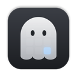
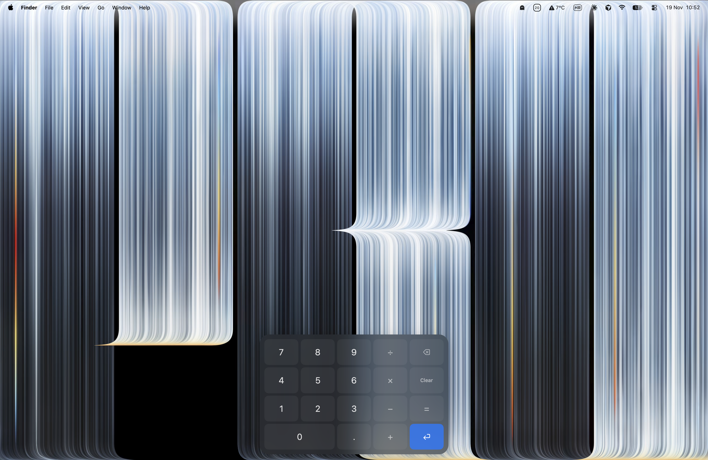

<div align="center">



# Ghostpad

**Your trackpad, secretly a numpad.**

A lightweight macOS menu bar app that turns your MacBook trackpad into an invisible number pad.

<br>



<br>

`Two-finger swipe` from the left edge&nbsp;&nbsp; · &nbsp;&nbsp;Real numpad keys&nbsp;&nbsp; · &nbsp;&nbsp;Custom layouts

</div>

---

## A number pad that isn't there.

Ghostpad hides a full number pad inside your trackpad. Swipe in from the left edge and a soft keypad appears on screen, showing exactly where your fingers are. Tap a spot on the trackpad and the key goes straight to the app you're using.

- **Swipe to open** — Two fingers from the left edge of the trackpad, just like opening Notification Center from the right.
- **Real numpad input** — Sends true keypad keys, so calculators, spreadsheets and forms treat it like a full-size keyboard.
- **See your fingers** — The keypad shows where you're touching and lights up each key as you press it.
- **Cursor stays put** — While the keypad is open, the pointer, clicks and scrolling are paused.
- **Make it yours** — Choose where the keypad appears, its size and opacity, or design your own layouts.
- **Local by design** — No network, no tracking. Everything stays on your Mac.

## Installation

**1. Install with Homebrew**

```bash
brew install --cask sharky-3/tap/ghostpad
```

**2. Allow the app to open**

If macOS blocks the first launch, open **System Settings → Privacy & Security** and select **Open Anyway** next to the Ghostpad security notification, if available.

**3. Grant Accessibility access**

Ghostpad needs Accessibility access to pause the pointer and type keys. When prompted, open **System Settings → Privacy & Security → Accessibility** and turn on **Ghostpad**.

**4. Launch Ghostpad**

Open Spotlight with `⌘ Space`, search for `Ghostpad`, and press Return.

Swipe two fingers in from the left edge of your trackpad to open the keypad.

## Using Ghostpad

| Action | How |
| --- | --- |
| Open the keypad | Two-finger swipe from the left edge toward the center |
| Type a key | Tap the matching spot on the trackpad |
| Close the keypad | Swipe two fingers back to the left, or press `Esc` |
| Settings | Click the ghost in the menu bar → **Settings…** |

The keypad also closes by itself after a short time without touches, so you're never left without a cursor.

## Updating

```bash
brew upgrade --cask ghostpad
```

## Requirements

- macOS 14 Sonoma or later
- A MacBook with a built-in trackpad
